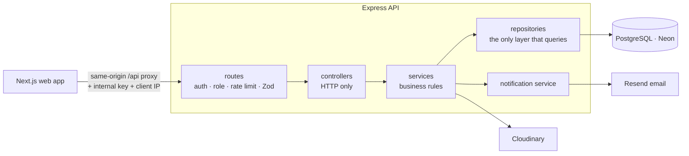

# HallMate API

A REST API for running a university women's residential hall in Bangladesh: seats and rooms, applications (seat, transfer, swap, leave), complaints and maintenance, billing with online payment, visitors, a digital ID card, meals, notifications, and the hall's public website. Built for **Nawab Faizunnesa Chowdhurani Hall, Jagannath University**, where the current site only publishes notices as PDFs.

**Stack:** Node.js 24 · Express 5 · TypeScript 6 · PostgreSQL · Prisma 7 (pg driver adapter) · Zod · JWT with rotating refresh tokens · Cloudinary · Resend email · Jest + Supertest

**Web app:** [hallmate-frontend](https://github.com/rifah07/hallmate-frontend) (Next.js, with screenshots) · **API docs:** Swagger UI at `/api-docs` · **Deploy:** [docs/DEPLOY.md](docs/DEPLOY.md) (free, no card: Vercel + Neon + Cloudinary + Resend)

---

## Why it's interesting

- **Security-first, and tested.** Two audits found and fixed issues from a shared placeholder password on every new account, to a house tutor being able to take over the super admin through an email change, to tutors reading every resident's phone number. Each fix is pinned by a regression test in [`src/shared/tests/security.test.ts`](src/shared/tests/security.test.ts).
- **Approvals change the real world.** Approving a transfer moves the student; a cancellation frees the bed; a swap trades beds only after the other student agrees from her own account. Each change is atomic.
- **Money handled carefully.** Whole taka in integers, payments counted only after a server-to-server check with SSLCommerz, and marking a bill paid is idempotent.
- **Role-based access that matches the real hall.** Ten roles (provost, house tutors per floor, assistant warden, office, dining, maintenance, guard, student, parent, super admin). A house tutor sees only her floor; support staff see no resident data at all.
- **Designed for free serverless hosting.** Stateless JWT auth, in-app notifications by polling instead of WebSockets, logs to stdout, one Prisma client per process, and email that degrades gracefully: a code that can't be emailed is handed to the provost instead of lost.

## Features

| Area | What's built |
|---|---|
| Accounts | University-ID login, first login with a one-time password, forgot/reset by emailed code, change password, rotating refresh tokens, temporary lockout |
| People | Bulk create from Excel/CSV, profiles with per-role editable fields, roles and account states (active, suspended, seat cancelled, graduated...) with reasons |
| Rooms | A 16-storey building (bedrooms on floors 5 to 16), assign / unassign / transfer with bed numbers, occupancy and vacancy views, floor-scoped access for house tutors |
| Applications | Seat, cancellation, transfer, swap, leave, complaint, maintenance; assign to staff; **approving changes the real world**: a seat is allocated, a transfer moves her, a cancellation frees the bed, a swap trades beds (only after the other student consents herself) |
| Billing | Yearly seat-renewal bills for every resident in one action (safe to run twice), fines, online payment through **SSLCommerz** (bKash, Nagad, Rocket, cards), cash and bank payments recorded by the provost, receipts, overdue status |
| Notices | Hall-wide or per-floor notices with PDF attachments, expiry and withdrawal; house tutors post to their own floor |
| Visitors | Student pre-registers a visitor, her floor's tutor approves, the guard sees today's list and checks them in and out; the student is told when her visitor arrives |
| ID card | Digital hall ID with a signed QR code; guards scan it to see the photo and room; a cancelled seat stops the card immediately |
| Dashboards | One endpoint, shaped per role: a student's room, roommates, bills and requests; a tutor's floor; the provost's occupancy and renewal collection; the guard's day |
| Meals | Daily logs, cancellations up to 24 hours ahead (computed in Dhaka time, whatever the server's zone), planning counts for the dining staff |
| Notifications | In-app inbox with unread badge and cursor pagination; emails for decisions, receipts, account and room changes |
| Public site | Hall info, provost history, house tutors, staff, notices, events, facilities, dining, gallery, achievements, FAQ, admissions, contact form, public applications with tracking |

## Architecture



Every feature is a module with the same shape:

```
src/modules/<feature>/
  routes/        URL → middleware chain → controller
  validations/   Zod schemas (body, query, params)
  controllers/   read req, call one service method, send the response
  services/      rules: who may do what, what happens next
  repositories/  Prisma queries (soft-delete filters, safe selects, atomic updates)
  types/  docs/  tests/
```

Cross-cutting code lives in `src/shared/`: auth and role middleware, error handler, rate limiters, logger, email, Cloudinary, the account-state rule, keyset cursors and Bangladesh-time dates.

The payment gateway sits behind an interface (`billing/gateways/payment-gateway.ts`), so the billing rules never touch HTTP and the tests run against a fake gateway.

## Security

| Risk | What the code does |
|---|---|
| Account takeover | Only the provost or super admin can change an email (the password-reset channel); the user is emailed when someone else edits her record |
| Broken access control | Per-role allow-list of editable fields; house tutors limited to their floor; ownership enforced inside queries (`where: { id, userId }`) |
| Leaking resident data | Resident search is staff-only and capped; a house tutor sees only students living on her floor (others answer 404, so IDs can't be probed); support staff see a task's location and the resident's name, never her phone, email or room |
| Lost or misdirected codes | If a one-time-password email fails, the provost gets the code to hand over; bulk upload skips existing people before emailing; a failed reset email answers exactly like an unknown ID |
| Brute force | 10 auth attempts per 15 min per IP; 15-minute lock after 5 wrong passwords; one-time and reset codes die after 5 wrong tries (atomic counters) |
| User enumeration | Same message and timing for unknown ID and wrong password (bcrypt against a dummy hash); status revealed only after a correct password |
| Stolen sessions | 15-min access tokens; refresh tokens hashed (SHA-256), single-use, reuse revokes all; password change ends every session; locked or cancelled accounts lose access on the next request |
| CSRF | Refresh cookie is HttpOnly, `SameSite=Strict`, scoped to `/api/auth` |
| Rate-limit bypass | Behind a proxy the client IP is trusted only with the shared internal key (`timingSafeEqual`) |
| Injection | Zod validation on every input; Prisma parameterised queries; user text escaped in email HTML |
| Unactivated accounts | Random unusable placeholder password; login refuses accounts that haven't set their own |
| Forged payments | A payment counts only after a server-to-server check with SSLCommerz, and only if amount and currency match the bill exactly; callbacks themselves are never trusted; marking paid is idempotent (conditional update in a transaction) |
| Money arithmetic | Amounts are whole taka in integers, never floating point |
| Forged ID cards | QR holds a token signed with a key derived only for cards, so a card can't be used as a login token and vice versa; every scan checks the live account |
| Race conditions | State changes (check-in, approval, payment) are conditional updates: two guards or a double tap can't apply the same change twice |
| Visitor privacy | No national ID numbers stored; the guard sees name, relation and room, never phone numbers |
| Leaky errors | Generic 500s to clients; full stack with the route in the logs; codes like `ACCOUNT_SEAT_CANCELLED` for the UI |

## Run locally

Requires Node 20.19+, Docker (for tests) and a PostgreSQL database ([Neon](https://neon.tech) is free, no card).

```bash
npm install
cp .env.example .env          # DATABASE_URL, JWT secrets, Cloudinary, Resend
npx prisma migrate deploy     # create the tables
npm run db:seed               # first super admin (SUPER_ADMIN_* in .env) and the hall's public content
npm run dev                   # http://localhost:5000 · docs at /api-docs
```

Without `RESEND_API_KEY`, emails (one-time passwords, reset codes) are printed to the console instead of sent.

## Tests

Integration tests run against a real PostgreSQL in Docker, never your real database: `jest.setup.js` refuses to start unless `DATABASE_URL` points at localhost.

```bash
cp .env.test.example .env.test
npm run test:db               # throwaway Postgres in RAM, migrated
npm test
docker stop hallmate-test-db
```

| Suite | Covers |
|---|---|
| `auth` | Login, first login, refresh rotation and reuse, reset, change password, account states |
| `users` | CRUD, bulk upload, roles, statuses, profile pictures (these need real Cloudinary keys) |
| `rooms` | Assign, transfer, floor scoping, occupancy |
| `notifications` | Cursor pages, ownership, unread count, complaint fan-out to the right staff |
| `applications` | Approval side effects, atomic transfers, swap consent by the other student only |
| `billing` | Renewals issued once, forged IPN, wrong amount, double IPN, refund flag, cash payments (fake gateway, no network) |
| `notices` | Floor scoping, who may post where, fake PDFs, expiry and withdrawal |
| `visitors` | Date window, floor approval, guard list, check-in once and only on the day |
| `id-card` | Genuine vs tampered cards, card and login tokens not interchangeable, cancellation |
| `dashboard` | Each role sees its own shape and nothing more |
| `meals` | Cancel and status, Dhaka-time deadlines, range limits, planning counts |
| `security` | One test per audit finding |

## Commands

| Command | What it does |
|---|---|
| `npm run dev` | Dev server with reload (`node --watch`) |
| `npm test` | All tests (start `npm run test:db` first) |
| `npm run lint` | ESLint with auto-fix |
| `npx prisma migrate deploy` | Apply migrations to the database in `.env` |
| `npx prisma studio` | Browse the database |

## Status

| | |
|---|---|
| Done | Auth, users, rooms, applications with approval effects, meals, notices, billing with SSLCommerz, visitors, QR ID card, dashboards, notifications, public site, two security audits, the [web app](https://github.com/rifah07/hallmate-frontend) |
| Next | Deployment · a verified email domain so residents receive codes by email |
| Left out on purpose | Parent portal, SOS button, study-room and guest-room booking, gate hardware, provost fund: each needs a policy decision or hardware the hall doesn't have yet |

## Author

**Rifah Sajida Deya** · [GitHub](https://github.com/rifah07)
